# Thiết kế Cơ sở dữ liệu: Phân tích dữ liệu, ERD, Đặc tả Bảng & Ràng buộc Toàn vẹn

> **Hệ quản trị CSDL đích**: PostgreSQL (theo `[QĐ Q-41, Q-43]`).
> **Múi giờ chuẩn**: `Asia/Ho_Chi_Minh` (`TIMESTAMPTZ`).
> **Đơn vị tiền tệ**: Số nguyên đồng Việt Nam (`BIGINT` / `INTEGER`), không dùng số thực dấu phẩy động cho tiền tệ.

---

## Phần I. Phân tích dữ liệu mức khái niệm (Data Analysis)

### 1. Danh mục Thực thể (`E01` – `E20`)

| Mã | Thực thể | Bảng vật lý tương ứng | Thuộc tính quan trọng & bổ sung | Nguồn |
|---|---|---|---|---|
| **E01** | **Tài khoản** | `users` | Tên đăng nhập (`username`), mật khẩu băm (`password_hash`), họ tên (`full_name`), SĐT (`phone`), email (`email`), trạng thái (`ACTIVE` / `READ_ONLY` / `LOCKED`), bắt buộc đổi mật khẩu (`must_change_password`), hạn cuối chỉ đọc (`read_only_until`), đăng nhập gần nhất (`last_login_at`), đếm đăng nhập sai (`failed_login_attempts`, `locked_until`) | BR-01…BR-06, D-17; API 2.6, 4.2 |
| **E02** | **Vai trò của tài khoản** | `user_roles` | Liên kết nhiều – nhiều giữa tài khoản và 5 vai trò (`SYSTEM_ADMIN`, `OWNER`, `MANAGER`, `ACCOUNTANT`, `TENANT`), người gán (`assigned_by`), thời điểm gán (`assigned_at`) | BR-02, BR-03; API 2.6, 4.1 |
| **E03** | **Tòa nhà / Cấu hình** | `building_settings` | Tên tòa (`building_name`), địa chỉ (`address`), ngày thu mặc định (`default_billing_day`: 1–31), số ngày hạn thanh toán mặc định (`default_payment_term_days`: 0–60), quy tắc làm tròn (`rounding_unit = 1000`, `rounding_mode = 'NEAREST'`), người cập nhật (`updated_by`) | BR-10, BR-20, BR-22, Q-50, Q-60; API SET-01, SET-02 |
| **E04** | **Phòng** | `rooms` | Mã phòng (`code`), tầng (`floor`), diện tích m² (`area_m2`), giá niêm yết (`listed_price`), cờ bảo trì (`is_under_maintenance`), ghi chú (`note`). *(Trạng thái hiển thị `VACANT` / `OCCUPIED` / `MAINTENANCE` được suy ra từ hợp đồng hiệu lực và `is_under_maintenance`)* | BR-10, BR-11; API ROOM-01…04, 4.2 |
| **E05** | **Người ở** | `occupants` | Họ tên (`full_name`), ngày sinh (`date_of_birth`), giới tính (`gender`), quê quán (`hometown`), SĐT (`phone`), email (`email`), CCCD (`id_number`), tình trạng tạm trú (`residence_registration_status`), tài khoản liên kết (`user_id`), cờ đã ẩn (`is_anonymized`), thời điểm ẩn (`anonymized_at`), ghi chú (`note`) | BR-09, BR-14, BR-16, BR-37; API OCC-01…06, 4.2 |
| **E06** | **Hợp đồng** | `contracts` | Phòng (`room_id`), người đứng tên (`primary_occupant_id`), tài khoản người thuê (`tenant_user_id`), số HĐ giấy (`contract_number`), ngày ký (`signed_on`), ngày bắt đầu (`start_date`), ngày kết thúc (`end_date`), giá thuê (`monthly_rent`), tiền cọc (`deposit`), chỉ số điện/nước bàn giao (`initial_electricity_reading`, `initial_water_reading`), ngày kết thúc thực tế (`ended_on`), ghi chú kết thúc & tiền cọc (`end_note`), trạng thái (`UPCOMING` / `ACTIVE` / `ENDED`) | BR-03, BR-11, BR-12, Q-48, Q-53; API CTR-01…06, 4.2 |
| **E07** | **Người ở theo hợp đồng** | `contract_occupants` | Hợp đồng (`contract_id`), người ở (`occupant_id`), là người đứng tên (`is_primary`), quan hệ với người đứng tên (`relationship_to_primary`), ngày vào ở (`move_in_date`), ngày rời đi (`move_out_date`), ghi chú (`note`) | BR-13, BR-14, BR-19, Q-49; API 4.2 |
| **E08** | **Khoản thu** | `charge_types` | Tên khoản thu (`name`), cách tính (`calculation_method`: `CONTRACT_RENT`, `METER`, `PER_PERSON`, `PER_ROOM`, `PER_VEHICLE`, `MANUAL`), loại công tơ (`meter_type`: `ELECTRICITY`, `WATER`), đơn vị tính (`unit`), bắt buộc hay tùy chọn (`is_mandatory`), đang dùng (`is_active`) | BR-17, BR-23, BR-24, API-D06, Q-40, Q-52; API CHG-01…03, 4.2 |
| **E09** | **Đơn giá** | `charge_prices` | Khoản thu (`charge_type_id`), đơn giá (`unit_price`), ngày bắt đầu hiệu lực (`effective_from`), đã dùng lập hóa đơn (`is_used`), người tạo (`created_by`), thời điểm tạo (`created_at`) | BR-18, BR-19; API CHG-04…06, 4.2 |
| **E10** | **Dịch vụ đăng ký của HĐ** | `contract_services` | Hợp đồng (`contract_id`), khoản thu tùy chọn (`charge_type_id`), số lượng (`quantity` ≥ 1), kỳ bắt đầu áp dụng (`from_period`), kỳ kết thúc áp dụng (`to_period`) | BR-17, BR-19; API CTR-05, 4.2 |
| **E11** | **Chỉ số công tơ** | `meter_readings` | Phòng (`room_id`), loại công tơ (`meter_type`), kỳ (`period`), chỉ số cũ (`previous_reading`), chỉ số mới (`current_reading`), sản lượng tiêu thụ (`consumption`), đã khóa (`is_locked`), người ghi (`recorded_by`), thời điểm ghi (`recorded_at`) | BR-17, BR-19, Q-51; API MTR-01…02, 4.2 |
| **E12** | **Kỳ hóa đơn & Phát sinh** | `billing_periods`, `extra_charges` | Kỳ thu (`period`: `YYYY-MM`), ngày thu (`billing_date`), hạn thanh toán (`due_date`), người lên lịch (`created_by`); kèm bảng khoản phát sinh chờ phát hành (`extra_charges`: `period_id`, `room_id`, `contract_id`, `description`, `amount`, `note`) | BR-17, BR-20, Q-50, US-16; API BIL-01…08, 4.2 |
| **E13** | **Hóa đơn** | `invoices` | Mã hóa đơn tự sinh (`code`: `HD-YYYYMM-Pxxx`), kỳ (`period_id`), phòng (`room_id`), hợp đồng (`contract_id`), tên người đứng tên đã chụp (`primary_tenant_name`), ngày thu (`billing_date`), hạn thanh toán (`due_date`), tổng trước làm tròn (`subtotal`), số tiền làm tròn (`rounding_amount`), tổng sau làm tròn (`total_amount`), tổng điều chỉnh (`adjustment_total`), tổng phải trả (`amount_due`), đã trả (`paid_amount`), còn nợ (`balance`), trạng thái (`UNPAID` / `PARTIALLY_PAID` / `PAID`), thời điểm & người phát hành (`issued_at`, `issued_by`) | BR-19…BR-23, BR-25, BR-27; API BIL-05, INV-01…02, 4.2, 4.3 |
| **E14** | **Dòng hóa đơn** | `invoice_lines` | Hóa đơn (`invoice_id`), khoản thu (`charge_type_id`, nullable), mô tả đã chụp (`description`), cách tính đã chụp (`calculation_method`), số lượng (`quantity`), đơn vị (`unit`), đơn giá (`unit_price`), thành tiền (`amount`), chỉ số cũ/mới (`previous_reading`, `current_reading`) | BR-17, BR-19; API 4.2 |
| **E15** | **Phiếu điều chỉnh** | `invoice_adjustments` | Hóa đơn (`invoice_id`), số tiền điều chỉnh (`amount` ≠ 0, dương/âm), lý do (`reason`), trạng thái (`PENDING` / `APPROVED` / `REJECTED`), người lập & thời điểm (`requested_by`, `requested_at`), người duyệt, thời điểm & ghi chú duyệt (`decided_by`, `decided_at`, `decision_note`) | BR-25, BR-36, D-16; API ADJ-01…04, 4.2 |
| **E16** | **Thanh toán & Yêu cầu hủy** | `payments`, `payment_cancellation_requests` | Số biên lai (`receipt_number`: `BL-YYYYMM-xxxx`), hóa đơn (`invoice_id`), số tiền (`amount` > 0), hình thức (`CASH` / `BANK_TRANSFER`), mã tham chiếu CK (`reference_code`), người nộp (`payer_occupant_id`, `payer_name`), ngày nộp (`paid_on`), ghi chú (`note`), trạng thái (`VALID` / `PENDING_CANCELLATION` / `CANCELLED`), người thu (`recorded_by`, `recorded_at`), thông tin hủy & yêu cầu duyệt hủy | BR-27…BR-31, BR-33, D-16, Q-57, Q-58; API PAY-01…08, 4.2 |
| **E17** | **Yêu cầu người thuê** | `tenant_requests` | Loại yêu cầu (`OCCUPANT_CHANGE` / `MAINTENANCE`), phòng (`room_id`), hợp đồng (`contract_id`), tiêu đề (`title`), mô tả (`description`), hành động biến động người ở (`occupant_change_action`: `ADD` / `MOVE_OUT` / `UPDATE`), người ở mục tiêu (`target_occupant_id`), dữ liệu đề xuất (`proposed_data` JSONB), ngày rời đi (`move_out_date`), trạng thái (`status`), người gửi (`submitted_by`, `submitted_at`), người xử lý (`handled_by`, `handled_at`, `response_note`) | BR-07, BR-15, Q-55; API TEN-07…08, REQ-01…05, 4.2 |
| **E18** | **Loại chi & Khoản chi** | `expense_categories`, `expenses` | Danh mục loại chi (`name`, `is_active`) và khoản chi (`category_id`, `spent_on`, `amount` > 0, `description`, `recorded_by`, `recorded_at`) | BR-35, BR-36, Q-54; API EXP-01…04, 4.2 |
| **E19** | **Thông báo** | `notifications` | Người nhận (`user_id`), loại (`INVOICE_ISSUED`, `INVOICE_DUE_SOON`, `INVOICE_OVERDUE`, `REQUEST_PROCESSED`), tiêu đề (`title`), nội dung (`message`), đối tượng liên quan (`related_type`, `related_id`), đã đọc (`is_read`, `read_at`), thời điểm tạo (`created_at`) | BR-32, BR-34; API NTF-01…03, 4.2 |
| **E20** | **Nhật ký** | `audit_logs` | Thời điểm (`occurred_at`), người thực hiện (`actor_id`, `actor_username`, `actor_full_name`), hành động (`action`), loại & ID thực thể (`entity_type`, `entity_id`), tóm tắt (`summary`), giá trị trước/sau (`before_data`, `after_data` JSONB), mã truy vết (`request_id`) | BR-36; API AUD-01, 2.8, 4.2, 4.4 |

---

## Phần II. Sơ đồ Thực thể – Liên kết (ERD)

```mermaid
erDiagram
    users ||--|{ user_roles : "has (E01-E02)"
    users |o--o| occupants : "linked to (E01-E05)"
    rooms ||--o{ contracts : "leased via (E04-E06)"
    occupants ||--o{ contracts : "primary tenant (E05-E06)"
    users ||--o{ contracts : "tenant account (E01-E06)"
    contracts ||--|{ contract_occupants : "includes (E06-E07)"
    occupants ||--o{ contract_occupants : "resides in (E05-E07)"
    charge_types ||--o{ charge_prices : "priced over time (E08-E09)"
    contracts ||--o{ contract_services : "subscribes (E06-E10)"
    charge_types ||--o{ contract_services : "optional service (E08-E10)"
    rooms ||--o{ meter_readings : "records (E04-E11)"
    billing_periods ||--o{ extra_charges : "has draft extra (E12)"
    rooms ||--o{ extra_charges : "incurs (E04-E12)"
    contracts ||--o{ extra_charges : "under (E06-E12)"
    billing_periods ||--o{ invoices : "generates (E12-E13)"
    rooms ||--o{ invoices : "billed to (E04-E13)"
    contracts ||--o{ invoices : "billed under (E06-E13)"
    invoices ||--|{ invoice_lines : "contains (E13-E14)"
    charge_types |o--o{ invoice_lines : "snapshot of (E08-E14)"
    invoices ||--o{ invoice_adjustments : "adjusted by (E13-E15)"
    invoices ||--o{ payments : "paid by (E13-E16)"
    occupants |o--o{ payments : "paid by occupant (E05-E16)"
    payments ||--o{ payment_cancellation_requests : "cancellation requested (E16)"
    rooms ||--o{ tenant_requests : "submitted for (E04-E17)"
    contracts ||--o{ tenant_requests : "under contract (E06-E17)"
    users ||--o{ tenant_requests : "submits / handles (E01-E17)"
    expense_categories ||--o{ expenses : "categorizes (E18)"
    users ||--o{ notifications : "receives (E01-E19)"
    users |o--o{ audit_logs : "performs (E01-E20)"

    users {
        uuid id PK
        varchar username UK
        varchar password_hash
        varchar full_name
        varchar phone
        varchar email
        varchar status "ACTIVE | READ_ONLY | LOCKED"
        boolean must_change_password
        date read_only_until
        integer failed_login_attempts
        timestamptz locked_until
        timestamptz last_login_at
        timestamptz created_at
        timestamptz updated_at
    }

    user_roles {
        uuid user_id PK, FK
        varchar role PK "SYSTEM_ADMIN | OWNER | MANAGER | ACCOUNTANT | TENANT"
        uuid assigned_by FK
        timestamptz assigned_at
    }

    building_settings {
        smallint id PK "Always 1"
        varchar building_name
        varchar address
        smallint default_billing_day "1..31"
        smallint default_payment_term_days "0..60"
        integer rounding_unit "1000"
        varchar rounding_mode "NEAREST"
        uuid updated_by FK
        timestamptz updated_at
    }

    rooms {
        uuid id PK
        varchar code UK
        smallint floor
        numeric area_m2
        bigint listed_price
        boolean is_under_maintenance
        text note
        timestamptz created_at
        timestamptz updated_at
    }

    occupants {
        uuid id PK
        varchar full_name
        date date_of_birth
        varchar gender "MALE | FEMALE | OTHER"
        varchar hometown
        varchar id_number "12 digits, partial UK"
        varchar phone
        varchar email
        varchar residence_registration_status "NOT_REGISTERED | REGISTERED"
        uuid user_id UK, FK
        boolean is_anonymized
        timestamptz anonymized_at
        text note
        timestamptz created_at
        timestamptz updated_at
    }

    contracts {
        uuid id PK
        uuid room_id FK
        varchar contract_number
        date signed_on
        uuid primary_occupant_id FK
        uuid tenant_user_id FK
        date start_date
        date end_date
        bigint monthly_rent
        bigint deposit
        integer initial_electricity_reading
        integer initial_water_reading
        varchar status "UPCOMING | ACTIVE | ENDED"
        date ended_on
        text end_note
        uuid created_by FK
        timestamptz created_at
        timestamptz updated_at
    }

    contract_occupants {
        uuid id PK
        uuid contract_id FK
        uuid occupant_id FK
        boolean is_primary
        varchar relationship_to_primary
        date move_in_date
        date move_out_date
        text note
    }

    charge_types {
        uuid id PK
        varchar name UK
        varchar calculation_method "CONTRACT_RENT | METER | PER_PERSON | PER_ROOM | PER_VEHICLE | MANUAL"
        varchar meter_type "ELECTRICITY | WATER | null"
        varchar unit
        boolean is_mandatory
        boolean is_active
        timestamptz created_at
        timestamptz updated_at
    }

    charge_prices {
        uuid id PK
        uuid charge_type_id FK
        bigint unit_price
        date effective_from
        boolean is_used
        uuid created_by FK
        timestamptz created_at
    }

    contract_services {
        uuid id PK
        uuid contract_id FK
        uuid charge_type_id FK
        integer quantity
        char from_period "YYYY-MM"
        char to_period "YYYY-MM | null"
        timestamptz updated_at
    }

    meter_readings {
        uuid id PK
        uuid room_id FK
        varchar meter_type "ELECTRICITY | WATER"
        char period "YYYY-MM"
        integer previous_reading
        integer current_reading
        integer consumption
        boolean is_locked
        uuid recorded_by FK
        timestamptz recorded_at
    }

    billing_periods {
        uuid id PK
        char period UK "YYYY-MM"
        date billing_date
        date due_date
        uuid created_by FK
        timestamptz created_at
    }

    extra_charges {
        uuid id PK
        uuid period_id FK
        uuid room_id FK
        uuid contract_id FK
        varchar description
        bigint amount
        text note
        uuid created_by FK
        timestamptz created_at
    }

    invoices {
        uuid id PK
        varchar code UK "HD-YYYYMM-Pxxx"
        uuid period_id FK
        uuid room_id FK
        uuid contract_id FK
        varchar primary_tenant_name
        date billing_date
        date due_date
        bigint subtotal
        integer rounding_amount
        bigint total_amount
        bigint adjustment_total
        bigint amount_due
        bigint paid_amount
        bigint balance
        varchar status "UNPAID | PARTIALLY_PAID | PAID"
        uuid issued_by FK
        timestamptz issued_at
    }

    invoice_lines {
        uuid id PK
        uuid invoice_id FK
        uuid charge_type_id FK
        varchar description
        varchar calculation_method
        integer quantity
        varchar unit
        bigint unit_price
        bigint amount
        integer previous_reading
        integer current_reading
        smallint sort_order
    }

    invoice_adjustments {
        uuid id PK
        uuid invoice_id FK
        bigint amount "!= 0"
        text reason
        varchar status "PENDING | APPROVED | REJECTED"
        uuid requested_by FK
        timestamptz requested_at
        uuid decided_by FK
        timestamptz decided_at
        text decision_note
    }

    payments {
        uuid id PK
        varchar receipt_number UK "BL-YYYYMM-xxxx"
        uuid invoice_id FK
        bigint amount "> 0"
        varchar method "CASH | BANK_TRANSFER"
        varchar reference_code
        uuid payer_occupant_id FK
        varchar payer_name
        date paid_on
        text note
        varchar status "VALID | PENDING_CANCELLATION | CANCELLED"
        uuid recorded_by FK
        timestamptz recorded_at
        timestamptz cancelled_at
        text cancel_reason
    }

    payment_cancellation_requests {
        uuid id PK
        uuid payment_id FK
        text reason
        varchar status "PENDING | APPROVED | REJECTED"
        uuid requested_by FK
        timestamptz requested_at
        uuid decided_by FK
        timestamptz decided_at
        text decision_note
    }

    tenant_requests {
        uuid id PK
        varchar type "OCCUPANT_CHANGE | MAINTENANCE"
        uuid room_id FK
        uuid contract_id FK
        varchar title
        text description
        varchar occupant_change_action "ADD | MOVE_OUT | UPDATE | null"
        uuid target_occupant_id FK
        jsonb proposed_data
        date move_out_date
        varchar status
        uuid submitted_by FK
        timestamptz submitted_at
        uuid handled_by FK
        timestamptz handled_at
        text response_note
    }

    expense_categories {
        uuid id PK
        varchar name UK
        boolean is_active
        timestamptz created_at
    }

    expenses {
        uuid id PK
        uuid category_id FK
        date spent_on
        bigint amount "> 0"
        text description
        uuid recorded_by FK
        timestamptz recorded_at
    }

    notifications {
        uuid id PK
        uuid user_id FK
        varchar type "INVOICE_ISSUED | INVOICE_DUE_SOON | INVOICE_OVERDUE | REQUEST_PROCESSED"
        varchar title
        text message
        varchar related_type "INVOICE | REQUEST | null"
        uuid related_id
        boolean is_read
        timestamptz read_at
        timestamptz created_at
    }

    audit_logs {
        uuid id PK
        timestamptz occurred_at
        uuid actor_id FK
        varchar actor_username
        varchar actor_full_name
        varchar action
        varchar entity_type
        uuid entity_id
        varchar summary
        jsonb before_data
        jsonb after_data
        varchar request_id
    }
```

---

## Phần III. Đặc tả chi tiết các Bảng (Table Specifications)

### 1. Bảng `users` (Thực thể E01 – Tài khoản)
Lưu thông tin xác thực và trạng thái tài khoản của nhân viên lẫn người thuê đứng tên hợp đồng.

| Tên cột | Kiểu dữ liệu | Bắt buộc | Mặc định | Ràng buộc / Mô tả |
|---|---|---|---|---|
| `id` | `UUID` | Có | `gen_random_uuid()` | **PK**. Định danh tài khoản |
| `username` | `VARCHAR(50)` | Có | – | **UK** (`LOWER(username)`). Tên đăng nhập duy nhất, không phân biệt hoa thường |
| `password_hash` | `VARCHAR(255)` | Có | – | Mật khẩu đã băm một chiều (bcrypt/argon2) |
| `full_name` | `VARCHAR(100)` | Có | – | Họ và tên hiển thị |
| `phone` | `VARCHAR(15)` | Không | `NULL` | Số điện thoại liên hệ (`^0[0-9]{9}$`) |
| `email` | `VARCHAR(150)` | Không | `NULL` | Địa chỉ email (phục vụ thông báo/đặt lại mật khẩu) |
| `status` | `VARCHAR(20)` | Có | `'ACTIVE'` | `ACTIVE` (hoạt động), `READ_ONLY` (chỉ đọc 30 ngày sau kết thúc HĐ), `LOCKED` (bị khóa) |
| `must_change_password` | `BOOLEAN` | Có | `TRUE` | `TRUE` khi mới tạo hoặc vừa được đặt lại mật khẩu |
| `read_only_until` | `DATE` | Không | `NULL` | Ngày cuối người thuê được đăng nhập chỉ đọc (`ended_on + 30 ngày`, BR-04, D-17) |
| `failed_login_attempts` | `SMALLINT` | Có | `0` | Số lần đăng nhập sai liên tiếp (`>= 0`) |
| `locked_until` | `TIMESTAMPTZ` | Không | `NULL` | Thời điểm hết hạn tạm khóa 15 phút khi đăng nhập sai 5 lần |
| `last_login_at` | `TIMESTAMPTZ` | Không | `NULL` | Thời điểm đăng nhập thành công gần nhất |
| `created_at` | `TIMESTAMPTZ` | Có | `NOW()` | Thời điểm tạo |
| `updated_at` | `TIMESTAMPTZ` | Có | `NOW()` | Thời điểm cập nhật gần nhất |

---

### 2. Bảng `user_roles` (Thực thể E02 – Vai trò của tài khoản)
Ánh xạ nhiều – nhiều giữa tài khoản và vai trò (BR-02).

| Tên cột | Kiểu dữ liệu | Bắt buộc | Mặc định | Ràng buộc / Mô tả |
|---|---|---|---|---|
| `user_id` | `UUID` | Có | – | **PK, FK** → `users(id) ON DELETE RESTRICT` |
| `role` | `VARCHAR(20)` | Có | – | **PK**. Nhận giá trị: `SYSTEM_ADMIN`, `OWNER`, `MANAGER`, `ACCOUNTANT`, `TENANT` |
| `assigned_by` | `UUID` | Không | `NULL` | **FK** → `users(id)`. Người gán vai trò |
| `assigned_at` | `TIMESTAMPTZ` | Có | `NOW()` | Thời điểm gán vai trò |

---

### 3. Bảng `building_settings` (Thực thể E03 – Cấu hình tòa nhà & lịch thu mặc định)
Bảng đơn dòng (`id = 1`) lưu thông tin chung của tòa chung cư mini và cấu hình lịch thu mặc định (BR-10, Q-50, Q-60).

| Tên cột | Kiểu dữ liệu | Bắt buộc | Mặc định | Ràng buộc / Mô tả |
|---|---|---|---|---|
| `id` | `SMALLINT` | Có | `1` | **PK**. Ràng buộc `CHECK (id = 1)` (chỉ 1 dòng duy nhất cho 1 tòa nhà) |
| `building_name` | `VARCHAR(100)` | Có | `'BlueMoon'` | Tên tòa nhà hiển thị trên hóa đơn, biên lai |
| `address` | `VARCHAR(255)` | Không | `NULL` | Địa chỉ tòa nhà |
| `default_billing_day` | `SMALLINT` | Có | `25` | Ngày thu gợi ý trong tháng (`1..31`) |
| `default_payment_term_days` | `SMALLINT` | Có | `10` | Số ngày từ ngày thu đến hạn thanh toán mặc định (`0..60`) |
| `rounding_unit` | `INTEGER` | Có | `1000` | Đơn vị làm tròn tổng hóa đơn (`1000` đ theo BR-22) |
| `rounding_mode` | `VARCHAR(20)` | Có | `'NEAREST'` | Hướng làm tròn (`NEAREST` – gần nhất theo Q-60) |
| `updated_by` | `UUID` | Không | `NULL` | **FK** → `users(id)` |
| `updated_at` | `TIMESTAMPTZ` | Có | `NOW()` | Thời điểm cập nhật |

---

### 4. Bảng `rooms` (Thực thể E04 – Phòng)
Danh sách các phòng trong tòa chung cư mini (BR-10, US-06).

| Tên cột | Kiểu dữ liệu | Bắt buộc | Mặc định | Ràng buộc / Mô tả |
|---|---|---|---|---|
| `id` | `UUID` | Có | `gen_random_uuid()` | **PK**. Định danh phòng |
| `code` | `VARCHAR(20)` | Có | – | **UK** (`UPPER(code)`). Mã phòng duy nhất (ví dụ `P101`, `P202`) |
| `floor` | `SMALLINT` | Có | – | Tầng (`floor > 0`) |
| `area_m2` | `NUMERIC(6,2)` | Có | – | Diện tích phòng tính bằng m² (`area_m2 > 0`) |
| `listed_price` | `BIGINT` | Có | – | Giá thuê niêm yết mặc định đ/tháng (`listed_price > 0`) |
| `is_under_maintenance` | `BOOLEAN` | Có | `FALSE` | `TRUE` khi Quản lý đặt trạng thái bảo trì (chỉ đặt được khi không có HĐ `ACTIVE`) |
| `note` | `TEXT` | Không | `NULL` | Ghi chú về phòng |
| `created_at` | `TIMESTAMPTZ` | Có | `NOW()` | Thời điểm tạo |
| `updated_at` | `TIMESTAMPTZ` | Có | `NOW()` | Thời điểm cập nhật |

---

### 5. Bảng `occupants` (Thực thể E05 – Người ở)
Thông tin cá nhân và tình trạng tạm trú của người ở (BR-14, BR-16, BR-37, US-08, US-11).

| Tên cột | Kiểu dữ liệu | Bắt buộc | Mặc định | Ràng buộc / Mô tả |
|---|---|---|---|---|
| `id` | `UUID` | Có | `gen_random_uuid()` | **PK**. Định danh người ở |
| `full_name` | `VARCHAR(100)` | Có | – | Họ và tên (luôn giữ lại kể cả sau khi ẩn dữ liệu sau 1 năm để đọc hóa đơn cũ) |
| `date_of_birth` | `DATE` | Không* | `NULL` | **Bắt buộc khi `is_anonymized = FALSE`**; xóa về `NULL` sau 1 năm rời đi (BR-37) |
| `gender` | `VARCHAR(10)` | Không | `NULL` | `MALE`, `FEMALE`, `OTHER` |
| `hometown` | `VARCHAR(200)` | Không* | `NULL` | Quê quán; **bắt buộc khi `is_anonymized = FALSE`** |
| `id_number` | `VARCHAR(12)` | Không* | `NULL` | Số CCCD 12 chữ số (`^[0-9]{12}$`); **bắt buộc & duy nhất khi `is_anonymized = FALSE`** |
| `phone` | `VARCHAR(15)` | Không | `NULL` | Số điện thoại (`^0[0-9]{9}$`); xóa về `NULL` khi ẩn dữ liệu |
| `email` | `VARCHAR(150)` | Không | `NULL` | Email cá nhân |
| `residence_registration_status` | `VARCHAR(20)` | Có | `'NOT_REGISTERED'` | `NOT_REGISTERED` (chưa khai báo), `REGISTERED` (đã khai báo tạm trú) |
| `user_id` | `UUID` | Không | `NULL` | **UK, FK** → `users(id)`. Tài khoản người thuê (nếu là người đứng tên hợp đồng) |
| `is_anonymized` | `BOOLEAN` | Có | `FALSE` | Cờ đã ẩn thông tin cá nhân nhạy cảm sau 1 năm rời đi (`DaAn`, BR-37) |
| `anonymized_at` | `TIMESTAMPTZ` | Không | `NULL` | Thời điểm hệ thống thực hiện ẩn dữ liệu cá nhân |
| `note` | `TEXT` | Không | `NULL` | Ghi chú |
| `created_at` | `TIMESTAMPTZ` | Có | `NOW()` | Thời điểm tạo |
| `updated_at` | `TIMESTAMPTZ` | Có | `NOW()` | Thời điểm cập nhật |

---

### 6. Bảng `contracts` (Thực thể E06 – Hợp đồng)
Lưu hợp đồng thuê phòng đã ký giấy được Quản lý nhập lên hệ thống (BR-11, BR-12, US-07, US-09).

| Tên cột | Kiểu dữ liệu | Bắt buộc | Mặc định | Ràng buộc / Mô tả |
|---|---|---|---|---|
| `id` | `UUID` | Có | `gen_random_uuid()` | **PK**. Định danh hợp đồng |
| `room_id` | `UUID` | Có | – | **FK** → `rooms(id) ON DELETE RESTRICT` |
| `contract_number` | `VARCHAR(50)` | Không | `NULL` | Số hợp đồng giấy (nếu có) |
| `signed_on` | `DATE` | Có | – | Ngày ký trên hợp đồng giấy |
| `primary_occupant_id` | `UUID` | Có | – | **FK** → `occupants(id) ON DELETE RESTRICT`. Người đứng tên hợp đồng |
| `tenant_user_id` | `UUID` | Có | – | **FK** → `users(id) ON DELETE RESTRICT`. Tài khoản cấp cho người đứng tên |
| `start_date` | `DATE` | Có | – | Ngày bắt đầu hiệu lực hợp đồng |
| `end_date` | `DATE` | Có | – | Ngày kết thúc theo hợp đồng (`end_date >= start_date`) |
| `monthly_rent` | `BIGINT` | Có | – | Giá thuê phòng hằng tháng chốt theo hợp đồng (`monthly_rent > 0`) |
| `deposit` | `BIGINT` | Có | `0` | Tiền đặt cọc (`deposit >= 0`) |
| `initial_electricity_reading` | `INTEGER` | Có | `0` | Chỉ số công tơ điện bàn giao lúc nhận phòng (`>= 0`) |
| `initial_water_reading` | `INTEGER` | Có | `0` | Chỉ số công tơ nước bàn giao lúc nhận phòng (`>= 0`) |
| `status` | `VARCHAR(20)` | Có | `'ACTIVE'` | `UPCOMING` (chưa đến `start_date`), `ACTIVE` (đang hiệu lực), `ENDED` (đã kết thúc) |
| `ended_on` | `DATE` | Không | `NULL` | Ngày kết thúc hợp đồng thực tế (khi thanh lý/kết thúc hợp đồng) |
| `end_note` | `TEXT` | Không | `NULL` | Ghi chú khi kết thúc hợp đồng và xử lý tiền cọc (Q-48) |
| `created_by` | `UUID` | Có | – | **FK** → `users(id)` |
| `created_at` | `TIMESTAMPTZ` | Có | `NOW()` | Thời điểm nhập hợp đồng |
| `updated_at` | `TIMESTAMPTZ` | Có | `NOW()` | Thời điểm cập nhật |

---

### 7. Bảng `contract_occupants` (Thực thể E07 – Người ở theo hợp đồng)
Theo dõi danh sách người ở và thời gian cư trú trong từng hợp đồng (BR-13, BR-14, BR-19, US-08).

| Tên cột | Kiểu dữ liệu | Bắt buộc | Mặc định | Ràng buộc / Mô tả |
|---|---|---|---|---|
| `id` | `UUID` | Có | `gen_random_uuid()` | **PK**. Định danh bản ghi cư trú |
| `contract_id` | `UUID` | Có | – | **FK** → `contracts(id) ON DELETE RESTRICT` |
| `occupant_id` | `UUID` | Có | – | **FK** → `occupants(id) ON DELETE RESTRICT` |
| `is_primary` | `BOOLEAN` | Có | `FALSE` | `TRUE` nếu là người đứng tên hợp đồng |
| `relationship_to_primary` | `VARCHAR(50)` | Không | `NULL` | Quan hệ với người đứng tên (`Bản thân`, `Bạn cùng phòng`, `Em trai`...) |
| `move_in_date` | `DATE` | Có | – | Ngày bắt đầu vào ở |
| `move_out_date` | `DATE` | Không | `NULL` | Ngày rời đi (`NULL` = đang ở; `move_out_date >= move_in_date`) |
| `note` | `TEXT` | Không | `NULL` | Ghi chú |

---

### 8. Bảng `charge_types` (Thực thể E08 – Danh mục khoản thu)
Các loại phí thu trong tòa nhà (BR-17, BR-23, BR-24, US-13).

| Tên cột | Kiểu dữ liệu | Bắt buộc | Mặc định | Ràng buộc / Mô tả |
|---|---|---|---|---|
| `id` | `UUID` | Có | `gen_random_uuid()` | **PK**. Mã khoản thu tự sinh |
| `name` | `VARCHAR(50)` | Có | – | **UK** (`LOWER(name)`). Tên khoản thu (1–50 ký tự, duy nhất) |
| `calculation_method` | `VARCHAR(20)` | Có | – | `CONTRACT_RENT`, `METER`, `PER_PERSON`, `PER_ROOM`, `PER_VEHICLE`, `MANUAL` |
| `meter_type` | `VARCHAR(20)` | Không | `NULL` | `ELECTRICITY` hoặc `WATER` (bắt buộc khi `calculation_method = 'METER'`, còn lại `NULL`) |
| `unit` | `VARCHAR(20)` | Có | – | Đơn vị tính hiển thị (`tháng`, `kWh`, `m³`, `người`, `phòng`, `xe`, `lần`) |
| `is_mandatory` | `BOOLEAN` | Có | `TRUE` | `TRUE`: áp dụng cho mọi hợp đồng; `FALSE`: chỉ áp dụng khi hợp đồng đăng ký ở `contract_services` |
| `is_active` | `BOOLEAN` | Có | `TRUE` | `FALSE`: ngừng áp dụng cho các kỳ hóa đơn mới |
| `created_at` | `TIMESTAMPTZ` | Có | `NOW()` | Thời điểm tạo |
| `updated_at` | `TIMESTAMPTZ` | Có | `NOW()` | Thời điểm cập nhật |

---

### 9. Bảng `charge_prices` (Thực thể E09 – Lịch sử đơn giá theo ngày hiệu lực)
Lưu đơn giá có ngày bắt đầu hiệu lực do Chủ nhà thiết lập (BR-18, BR-19, US-13).

| Tên cột | Kiểu dữ liệu | Bắt buộc | Mặc định | Ràng buộc / Mô tả |
|---|---|---|---|---|
| `id` | `UUID` | Có | `gen_random_uuid()` | **PK**. Định danh mức đơn giá |
| `charge_type_id` | `UUID` | Có | – | **FK** → `charge_types(id) ON DELETE RESTRICT` |
| `unit_price` | `BIGINT` | Có | – | Đơn giá (`0 < unit_price < 100000000000` – dưới 11 chữ số theo BR-24) |
| `effective_from` | `DATE` | Có | – | Ngày bắt đầu hiệu lực (**UK** trên cặp `(charge_type_id, effective_from)`) |
| `is_used` | `BOOLEAN` | Có | `FALSE` | `TRUE` khi đã được dùng trong ít nhất một hóa đơn đã phát hành (chặn sửa/xóa) |
| `created_by` | `UUID` | Có | – | **FK** → `users(id)`. Chủ nhà thiết lập |
| `created_at` | `TIMESTAMPTZ` | Có | `NOW()` | Thời điểm tạo |

---

### 10. Bảng `contract_services` (Thực thể E10 – Dịch vụ tùy chọn đăng ký theo hợp đồng)
Lưu các khoản thu tùy chọn (`is_mandatory = FALSE`, ví dụ Wifi, Gửi xe máy) mà hợp đồng đăng ký (BR-17, API CTR-05).

| Tên cột | Kiểu dữ liệu | Bắt buộc | Mặc định | Ràng buộc / Mô tả |
|---|---|---|---|---|
| `id` | `UUID` | Có | `gen_random_uuid()` | **PK** |
| `contract_id` | `UUID` | Có | – | **FK** → `contracts(id) ON DELETE CASCADE` |
| `charge_type_id` | `UUID` | Có | – | **FK** → `charge_types(id) ON DELETE RESTRICT` |
| `quantity` | `INTEGER` | Có | `1` | Số lượng đăng ký (`quantity >= 1`, ví dụ số lượng xe máy) |
| `from_period` | `CHAR(7)` | Có | – | Kỳ bắt đầu áp dụng (`YYYY-MM`) |
| `to_period` | `CHAR(7)` | Không | `NULL` | Kỳ kết thúc áp dụng (`YYYY-MM`; `NULL` = đến hết hợp đồng; `to_period >= from_period`) |
| `updated_at` | `TIMESTAMPTZ` | Có | `NOW()` | Thời điểm cập nhật |

---

### 11. Bảng `meter_readings` (Thực thể E11 – Chỉ số công tơ điện, nước theo kỳ)
Lưu chỉ số điện, nước hằng tháng của từng phòng (BR-17, Q-51, US-14).

| Tên cột | Kiểu dữ liệu | Bắt buộc | Mặc định | Ràng buộc / Mô tả |
|---|---|---|---|---|
| `id` | `UUID` | Có | `gen_random_uuid()` | **PK** |
| `room_id` | `UUID` | Có | – | **FK** → `rooms(id) ON DELETE RESTRICT` |
| `meter_type` | `VARCHAR(20)` | Có | – | `ELECTRICITY` (điện) hoặc `WATER` (nước) |
| `period` | `CHAR(7)` | Có | – | Kỳ ghi chỉ số (`YYYY-MM`). **UK** trên bộ `(room_id, meter_type, period)` |
| `previous_reading` | `INTEGER` | Có | – | Chỉ số cũ (`>= 0`; tự động lấy từ `current_reading` kỳ trước hoặc chỉ số bàn giao HĐ) |
| `current_reading` | `INTEGER` | Có | – | Chỉ số mới (`current_reading >= previous_reading`) |
| `consumption` | `INTEGER` | Có | – | Sản lượng tiêu thụ (`consumption = current_reading - previous_reading`) |
| `is_locked` | `BOOLEAN` | Có | `FALSE` | `TRUE` ngay khi hóa đơn của phòng trong kỳ `period` được phát hành (chặn sửa/xóa) |
| `recorded_by` | `UUID` | Có | – | **FK** → `users(id)`. Quản lý ghi chỉ số |
| `recorded_at` | `TIMESTAMPTZ` | Có | `NOW()` | Thời điểm ghi |

---

### 12. Bảng `billing_periods` (Thực thể E12a – Kỳ hóa đơn)
Lịch thu từng tháng do Kế toán thiết lập (BR-20, Q-50, US-15).

| Tên cột | Kiểu dữ liệu | Bắt buộc | Mặc định | Ràng buộc / Mô tả |
|---|---|---|---|---|
| `id` | `UUID` | Có | `gen_random_uuid()` | **PK** |
| `period` | `CHAR(7)` | Có | – | **UK**. Mã kỳ thu định dạng `YYYY-MM` (`^\d{4}-(0[1-9]|1[0-2])$`) |
| `billing_date` | `DATE` | Có | – | Ngày thu tiền trong kỳ do Kế toán đặt |
| `due_date` | `DATE` | Có | – | Hạn thanh toán của kỳ (`due_date >= billing_date`) |
| `created_by` | `UUID` | Có | – | **FK** → `users(id)`. Kế toán lên lịch |
| `created_at` | `TIMESTAMPTZ` | Có | `NOW()` | Thời điểm tạo |

---

### 13. Bảng `extra_charges` (Thực thể E12b – Khoản phát sinh trước khi phát hành)
Lưu các khoản thu phát sinh nhập tay cho từng phòng trước khi phát hành hóa đơn của kỳ (BR-17, US-16, API BIL-06, BIL-07).

| Tên cột | Kiểu dữ liệu | Bắt buộc | Mặc định | Ràng buộc / Mô tả |
|---|---|---|---|---|
| `id` | `UUID` | Có | `gen_random_uuid()` | **PK** |
| `period_id` | `UUID` | Có | – | **FK** → `billing_periods(id) ON DELETE RESTRICT` |
| `room_id` | `UUID` | Có | – | **FK** → `rooms(id) ON DELETE RESTRICT` |
| `contract_id` | `UUID` | Có | – | **FK** → `contracts(id) ON DELETE RESTRICT` |
| `description` | `VARCHAR(150)` | Có | – | Tên/nội dung khoản phát sinh (ví dụ `"Sửa vòi nước hỏng"`) |
| `amount` | `BIGINT` | Có | – | Số tiền phát sinh (`amount > 0`) |
| `note` | `TEXT` | Không | `NULL` | Ghi chú chi tiết |
| `created_by` | `UUID` | Có | – | **FK** → `users(id)`. Quản lý thêm |
| `created_at` | `TIMESTAMPTZ` | Có | `NOW()` | Thời điểm tạo |

---

### 14. Bảng `invoices` (Thực thể E13 – Hóa đơn tháng)
Hóa đơn đã phát hành cho từng phòng theo kỳ (BR-19…BR-23, BR-25, BR-27, US-15, US-22, US-29).

| Tên cột | Kiểu dữ liệu | Bắt buộc | Mặc định | Ràng buộc / Mô tả |
|---|---|---|---|---|
| `id` | `UUID` | Có | `gen_random_uuid()` | **PK** |
| `code` | `VARCHAR(30)` | Có | – | **UK**. Mã hóa đơn tự sinh `HD-YYYYMM-<mã phòng>` (ví dụ `HD-202611-P101`) |
| `period_id` | `UUID` | Có | – | **FK** → `billing_periods(id) ON DELETE RESTRICT`. **UK** trên `(room_id, period_id)` |
| `room_id` | `UUID` | Có | – | **FK** → `rooms(id) ON DELETE RESTRICT` |
| `contract_id` | `UUID` | Có | – | **FK** → `contracts(id) ON DELETE RESTRICT` |
| `primary_tenant_name` | `VARCHAR(100)` | Có | – | Họ tên người đứng tên chụp tại thời điểm phát hành |
| `billing_date` | `DATE` | Có | – | Ngày thu chụp từ kỳ hóa đơn |
| `due_date` | `DATE` | Có | – | Hạn thanh toán chụp từ kỳ hóa đơn |
| `subtotal` | `BIGINT` | Có | – | Tổng tiền các dòng hóa đơn trước làm tròn (`>= 0`) |
| `rounding_amount` | `INTEGER` | Có | `0` | Số tiền làm tròn (`total_amount - subtotal`, trong khoảng `-500..499`) |
| `total_amount` | `BIGINT` | Có | – | Tổng hóa đơn sau làm tròn đến `1.000` đ (`total_amount >= 0`, chia hết cho `1000`) |
| `adjustment_total` | `BIGINT` | Có | `0` | Tổng các phiếu điều chỉnh đã duyệt (`APPROVED`), có thể âm hoặc dương |
| `amount_due` | `BIGINT` | Có | – | Tổng phải trả (`amount_due = total_amount + adjustment_total >= 0`) |
| `paid_amount` | `BIGINT` | Có | `0` | Tổng tiền đã thanh toán (`VALID` + `PENDING_CANCELLATION`; `0 <= paid_amount <= amount_due`) |
| `balance` | `BIGINT` | Có | – | Số tiền còn nợ (`balance = amount_due - paid_amount >= 0`) |
| `status` | `VARCHAR(20)` | Có | `'UNPAID'` | `UNPAID` (`paid_amount = 0`), `PARTIALLY_PAID` (`0 < paid_amount < amount_due`), `PAID` (`balance = 0`). *(Trạng thái `OVERDUE` được tính khi đọc nếu `balance > 0` và `CURRENT_DATE > due_date`)* |
| `issued_by` | `UUID` | Có | – | **FK** → `users(id)`. Quản lý phát hành |
| `issued_at` | `TIMESTAMPTZ` | Có | `NOW()` | Thời điểm phát hành |

---

### 15. Bảng `invoice_lines` (Thực thể E14 – Dòng hóa đơn đã chụp)
Lưu bất biến từng dòng chi tiết của hóa đơn tại thời điểm phát hành (BR-19, I-09).

| Tên cột | Kiểu dữ liệu | Bắt buộc | Mặc định | Ràng buộc / Mô tả |
|---|---|---|---|---|
| `id` | `UUID` | Có | `gen_random_uuid()` | **PK** |
| `invoice_id` | `UUID` | Có | – | **FK** → `invoices(id) ON DELETE RESTRICT` |
| `charge_type_id` | `UUID` | Không | `NULL` | **FK** → `charge_types(id) ON DELETE RESTRICT` (`NULL` đối với khoản phát sinh nhập tay) |
| `description` | `VARCHAR(150)` | Có | – | Tên khoản thu hoặc nội dung khoản phát sinh đã chụp |
| `calculation_method` | `VARCHAR(20)` | Có | – | Cách tính đã chụp (`CONTRACT_RENT`, `METER`, `PER_PERSON`, `PER_ROOM`, `PER_VEHICLE`, `MANUAL`) |
| `quantity` | `INTEGER` | Có | – | Số lượng đã chụp (`>= 0`: số kWh, số m³, số người, số xe, hoặc `1`) |
| `unit` | `VARCHAR(20)` | Có | – | Đơn vị tính đã chụp (`tháng`, `kWh`, `m³`, `người`, `phòng`, `xe`, `lần`) |
| `unit_price` | `BIGINT` | Có | – | Đơn giá đã chụp tại thời điểm phát hành (`>= 0`) |
| `amount` | `BIGINT` | Có | – | Thành tiền (`amount = quantity * unit_price >= 0`) |
| `previous_reading` | `INTEGER` | Không | `NULL` | Chỉ số công tơ cũ đã chụp (chỉ có khi `calculation_method = 'METER'`) |
| `current_reading` | `INTEGER` | Không | `NULL` | Chỉ số công tơ mới đã chụp (chỉ có khi `calculation_method = 'METER'`) |
| `sort_order` | `SMALLINT` | Có | `0` | Thứ tự hiển thị dòng trên hóa đơn |

---

### 16. Bảng `invoice_adjustments` (Thực thể E15 – Phiếu điều chỉnh hóa đơn)
Lưu các phiếu điều chỉnh cộng/trừ tiền cho hóa đơn đã phát hành (BR-25, D-16, US-17).

| Tên cột | Kiểu dữ liệu | Bắt buộc | Mặc định | Ràng buộc / Mô tả |
|---|---|---|---|---|
| `id` | `UUID` | Có | `gen_random_uuid()` | **PK** |
| `invoice_id` | `UUID` | Có | – | **FK** → `invoices(id) ON DELETE RESTRICT` |
| `amount` | `BIGINT` | Có | – | Số tiền điều chỉnh (`amount <> 0`; dương: cộng thêm, âm: giảm trừ) |
| `reason` | `TEXT` | Có | – | Lý do điều chỉnh |
| `status` | `VARCHAR(20)` | Có | `'PENDING'` | `PENDING` (chờ duyệt), `APPROVED` (đã duyệt), `REJECTED` (từ chối) |
| `requested_by` | `UUID` | Có | – | **FK** → `users(id)`. Kế toán lập phiếu |
| `requested_at` | `TIMESTAMPTZ` | Có | `NOW()` | Thời điểm lập phiếu |
| `decided_by` | `UUID` | Không | `NULL` | **FK** → `users(id)`. Quản lý hoặc Chủ nhà duyệt (`decided_by <> requested_by`) |
| `decided_at` | `TIMESTAMPTZ` | Không | `NULL` | Thời điểm duyệt / từ chối |
| `decision_note` | `TEXT` | Không | `NULL` | Ghi chú của người duyệt |

---

### 17. Bảng `payments` (Thực thể E16a – Giao dịch thanh toán & Biên lai)
Ghi nhận các lần thu tiền một phần hoặc toàn bộ cho hóa đơn (BR-27…BR-31, BR-33, US-18, US-19).

| Tên cột | Kiểu dữ liệu | Bắt buộc | Mặc định | Ràng buộc / Mô tả |
|---|---|---|---|---|
| `id` | `UUID` | Có | `gen_random_uuid()` | **PK** |
| `receipt_number` | `VARCHAR(30)` | Có | – | **UK**. Số biên lai tự sinh `BL-YYYYMM-<4 chữ số>` (ví dụ `BL-202611-0001`) |
| `invoice_id` | `UUID` | Có | – | **FK** → `invoices(id) ON DELETE RESTRICT` |
| `amount` | `BIGINT` | Có | – | Số tiền nộp (`amount > 0`) |
| `method` | `VARCHAR(20)` | Có | – | Hình thức: `CASH` (tiền mặt), `BANK_TRANSFER` (chuyển khoản) |
| `reference_code` | `VARCHAR(100)` | Không | `NULL` | Mã giao dịch ngân hàng (khi `method = 'BANK_TRANSFER'`) |
| `payer_occupant_id` | `UUID` | Không | `NULL` | **FK** → `occupants(id) ON DELETE RESTRICT` (`NULL` nếu chọn người nộp "Khác") |
| `payer_name` | `VARCHAR(100)` | Có | – | Họ tên người nộp chụp lại trên biên lai |
| `paid_on` | `DATE` | Có | – | Ngày nộp tiền (`paid_on <= CURRENT_DATE` theo giờ Việt Nam, BR-30) |
| `note` | `TEXT` | Không | `NULL` | Ghi chú thanh toán |
| `status` | `VARCHAR(25)` | Có | `'VALID'` | `VALID` (hợp lệ), `PENDING_CANCELLATION` (chờ duyệt hủy), `CANCELLED` (đã hủy) |
| `recorded_by` | `UUID` | Có | – | **FK** → `users(id)`. Kế toán ghi nhận |
| `recorded_at` | `TIMESTAMPTZ` | Có | `NOW()` | Thời điểm ghi nhận |
| `cancelled_at` | `TIMESTAMPTZ` | Không | `NULL` | Thời điểm chính thức chuyển sang `CANCELLED` |
| `cancel_reason` | `TEXT` | Không | `NULL` | Lý do hủy thanh toán |

---

### 18. Bảng `payment_cancellation_requests` (Thực thể E16b – Yêu cầu hủy thanh toán)
Theo dõi quy trình Kế toán gửi yêu cầu hủy thanh toán ghi sai và Quản lý/Chủ nhà duyệt (BR-31, D-16, US-20).

| Tên cột | Kiểu dữ liệu | Bắt buộc | Mặc định | Ràng buộc / Mô tả |
|---|---|---|---|---|
| `id` | `UUID` | Có | `gen_random_uuid()` | **PK** |
| `payment_id` | `UUID` | Có | – | **FK** → `payments(id) ON DELETE RESTRICT` |
| `reason` | `TEXT` | Có | – | Lý do yêu cầu hủy |
| `status` | `VARCHAR(20)` | Có | `'PENDING'` | `PENDING`, `APPROVED`, `REJECTED` |
| `requested_by` | `UUID` | Có | – | **FK** → `users(id)`. Kế toán gửi yêu cầu |
| `requested_at` | `TIMESTAMPTZ` | Có | `NOW()` | Thời điểm gửi yêu cầu |
| `decided_by` | `UUID` | Không | `NULL` | **FK** → `users(id)`. Quản lý hoặc Chủ nhà duyệt (`decided_by <> requested_by`) |
| `decided_at` | `TIMESTAMPTZ` | Không | `NULL` | Thời điểm duyệt / từ chối |
| `decision_note` | `TEXT` | Không | `NULL` | Ghi chú của người duyệt |

---

### 19. Bảng `tenant_requests` (Thực thể E17 – Yêu cầu của người thuê)
Lưu yêu cầu thay đổi người ở (US-10) và yêu cầu sửa chữa, phản ánh (US-31) từ cổng người thuê.

| Tên cột | Kiểu dữ liệu | Bắt buộc | Mặc định | Ràng buộc / Mô tả |
|---|---|---|---|---|
| `id` | `UUID` | Có | `gen_random_uuid()` | **PK** |
| `type` | `VARCHAR(25)` | Có | – | `OCCUPANT_CHANGE` (thay đổi người ở) hoặc `MAINTENANCE` (sửa chữa, phản ánh) |
| `room_id` | `UUID` | Có | – | **FK** → `rooms(id) ON DELETE RESTRICT` |
| `contract_id` | `UUID` | Có | – | **FK** → `contracts(id) ON DELETE RESTRICT` |
| `title` | `VARCHAR(150)` | Có | – | Tiêu đề yêu cầu |
| `description` | `TEXT` | Có | – | Nội dung chi tiết yêu cầu (không được rỗng theo AC-10-03) |
| `occupant_change_action` | `VARCHAR(20)` | Không | `NULL` | `ADD`, `MOVE_OUT`, `UPDATE` (chỉ có khi `type = 'OCCUPANT_CHANGE'`) |
| `target_occupant_id` | `UUID` | Không | `NULL` | **FK** → `occupants(id)` (khi `action IN ('MOVE_OUT', 'UPDATE')`) |
| `proposed_data` | `JSONB` | Không | `NULL` | Thông tin người ở đề xuất thêm/sửa (họ tên, ngày sinh, quê quán, CCCD...) |
| `move_out_date` | `DATE` | Không | `NULL` | Ngày rời đi đề xuất (khi `action = 'MOVE_OUT'`) |
| `status` | `VARCHAR(20)` | Có | – | Với `OCCUPANT_CHANGE`: `PENDING`, `APPROVED`, `REJECTED`. Với `MAINTENANCE`: `NEW`, `IN_PROGRESS`, `DONE`, `REJECTED` |
| `submitted_by` | `UUID` | Có | – | **FK** → `users(id)`. Tài khoản người thuê gửi |
| `submitted_at` | `TIMESTAMPTZ` | Có | `NOW()` | Thời điểm gửi |
| `handled_by` | `UUID` | Không | `NULL` | **FK** → `users(id)`. Quản lý xử lý |
| `handled_at` | `TIMESTAMPTZ` | Không | `NULL` | Thời điểm xử lý |
| `response_note` | `TEXT` | Không | `NULL` | Phản hồi của Quản lý |

---

### 20. Bảng `expense_categories` & `expenses` (Thực thể E18 – Danh mục loại chi & Khoản chi)
Phục vụ ghi nhận chi phí vận hành tòa nhà và báo cáo Thu – Chi – Lợi nhuận (BR-35, Q-54, US-24, US-25).

**Bảng `expense_categories` (Danh mục loại chi)**

| Tên cột | Kiểu dữ liệu | Bắt buộc | Mặc định | Ràng buộc / Mô tả |
|---|---|---|---|---|
| `id` | `UUID` | Có | `gen_random_uuid()` | **PK** |
| `name` | `VARCHAR(100)` | Có | – | **UK** (`LOWER(name)`). Tên loại chi (Sửa chữa, Điện nước chung, Lương, Khác...) |
| `is_active` | `BOOLEAN` | Có | `TRUE` | Trạng thái sử dụng |
| `created_at` | `TIMESTAMPTZ` | Có | `NOW()` | Thời điểm tạo |

**Bảng `expenses` (Khoản chi)**

| Tên cột | Kiểu dữ liệu | Bắt buộc | Mặc định | Ràng buộc / Mô tả |
|---|---|---|---|---|
| `id` | `UUID` | Có | `gen_random_uuid()` | **PK** |
| `category_id` | `UUID` | Có | – | **FK** → `expense_categories(id) ON DELETE RESTRICT` |
| `spent_on` | `DATE` | Có | – | Ngày chi (`spent_on <= CURRENT_DATE`) |
| `amount` | `BIGINT` | Có | – | Số tiền chi (`amount > 0`) |
| `description` | `TEXT` | Không | `NULL` | Mô tả chi tiết khoản chi |
| `recorded_by` | `UUID` | Có | – | **FK** → `users(id)`. Kế toán ghi nhận |
| `recorded_at` | `TIMESTAMPTZ` | Có | `NOW()` | Thời điểm ghi nhận |

---

### 21. Bảng `notifications` (Thực thể E19 – Thông báo trong ứng dụng)
Lưu thông báo gửi tới người thuê và nhân viên (BR-32, BR-34, US-32).

| Tên cột | Kiểu dữ liệu | Bắt buộc | Mặc định | Ràng buộc / Mô tả |
|---|---|---|---|---|
| `id` | `UUID` | Có | `gen_random_uuid()` | **PK** |
| `user_id` | `UUID` | Có | – | **FK** → `users(id) ON DELETE CASCADE`. Người nhận thông báo |
| `type` | `VARCHAR(30)` | Có | – | `INVOICE_ISSUED`, `INVOICE_DUE_SOON`, `INVOICE_OVERDUE`, `REQUEST_PROCESSED` |
| `title` | `VARCHAR(150)` | Có | – | Tiêu đề thông báo |
| `message` | `TEXT` | Có | – | Nội dung thông báo |
| `related_type` | `VARCHAR(20)` | Không | `NULL` | `INVOICE` hoặc `REQUEST` |
| `related_id` | `UUID` | Không | `NULL` | Định danh bản ghi hóa đơn hoặc yêu cầu liên quan |
| `is_read` | `BOOLEAN` | Có | `FALSE` | Trạng thái đã đọc |
| `read_at` | `TIMESTAMPTZ` | Không | `NULL` | Thời điểm đánh dấu đã đọc |
| `created_at` | `TIMESTAMPTZ` | Có | `NOW()` | Thời điểm tạo thông báo |

---

### 22. Bảng `audit_logs` (Thực thể E20 – Nhật ký hệ thống)
Lưu dấu vết bất biến cho mọi thao tác về tiền, hợp đồng, tài khoản và việc xem/xuất dữ liệu cá nhân (BR-36, US-33).

| Tên cột | Kiểu dữ liệu | Bắt buộc | Mặc định | Ràng buộc / Mô tả |
|---|---|---|---|---|
| `id` | `UUID` | Có | `gen_random_uuid()` | **PK** |
| `occurred_at` | `TIMESTAMPTZ` | Có | `NOW()` | Thời điểm xảy ra sự kiện |
| `actor_id` | `UUID` | Không | `NULL` | **FK** → `users(id) ON DELETE RESTRICT` |
| `actor_username` | `VARCHAR(50)` | Có | – | Tên đăng nhập chụp lại tại thời điểm thao tác |
| `actor_full_name` | `VARCHAR(100)` | Có | – | Họ tên người thực hiện chụp lại |
| `action` | `VARCHAR(50)` | Có | – | Mã hành động chuẩn (theo Mục 4.4 API Spec: `INVOICES_ISSUED`, `PAYMENT_CREATED`, `PERSONAL_DATA_VIEWED`...) |
| `entity_type` | `VARCHAR(30)` | Có | – | Loại đối tượng bị tác động (`INVOICE`, `PAYMENT`, `OCCUPANT`, `CONTRACT`, `PRICE`...) |
| `entity_id` | `UUID` | Không | `NULL` | ID bản ghi bị tác động (`NULL` khi xuất danh sách hàng loạt `OCC-06`) |
| `summary` | `VARCHAR(255)` | Có | – | Mô tả ngắn tiếng Việt hiển thị cho Chủ nhà |
| `before_data` | `JSONB` | Không | `NULL` | Giá trị trước khi thay đổi (tuyệt đối không lưu `password_hash`) |
| `after_data` | `JSONB` | Không | `NULL` | Giá trị sau khi thay đổi |
| `request_id` | `VARCHAR(64)` | Không | `NULL` | Mã `X-Request-Id` của HTTP request |

---

### 23. Bảng kỹ thuật `idempotency_keys` (Chống gửi lặp thao tác tạo hợp đồng / phát hành HĐ / thu tiền)
Đảm bảo quy tắc chống gửi lặp trong 24 giờ theo Mục 2.7 của `API-Specification.docx`.

| Tên cột | Kiểu dữ liệu | Bắt buộc | Mặc định | Ràng buộc / Mô tả |
|---|---|---|---|---|
| `key` | `UUID` | Có | – | **PK**. Giá trị header `Idempotency-Key` |
| `user_id` | `UUID` | Có | – | **PK, FK** → `users(id) ON DELETE CASCADE` |
| `endpoint` | `VARCHAR(100)` | Có | – | Mã/đường dẫn endpoint (`PAY-01`, `CTR-02`, `BIL-05`) |
| `request_hash` | `CHAR(64)` | Có | – | Băm SHA-256 của request body để phát hiện lỗi `409 IDEMPOTENCY_KEY_REUSED` |
| `response_status` | `SMALLINT` | Có | – | Mã HTTP đã trả về lần đầu |
| `response_body` | `JSONB` | Có | – | Nội dung JSON phản hồi lần đầu |
| `created_at` | `TIMESTAMPTZ` | Có | `NOW()` | Thời điểm tạo |
| `expires_at` | `TIMESTAMPTZ` | Có | `NOW() + INTERVAL '24 hours'` | Thời điểm hết hạn khóa |

---

## Phần IV. Đặc tả Ràng buộc Toàn vẹn (Integrity Constraints)

### 1. Ràng buộc Duy nhất (Unique Constraints)

| Mã | Bảng áp dụng | Thuộc tính / Tổ hợp thuộc tính | Điều kiện áp dụng | Mô tả ràng buộc | Căn cứ |
|---|---|---|---|---|---|
| **UK-01** | `users` | `username` | Toàn bảng (không phân biệt hoa/thường) | Tên đăng nhập là duy nhất trên toàn hệ thống | I-01, API 4.2 |
| **UK-02** | `rooms` | `code` | Toàn bảng (không phân biệt hoa/thường) | Mã phòng là duy nhất trong tòa nhà | I-02, AC-06-02 |
| **UK-03** | `charge_types` | `name` | Toàn bảng (không phân biệt hoa/thường) | Tên khoản thu là duy nhất trong danh mục bảng giá | I-02, R-08, AC-13-05 |
| **UK-04** | `charge_prices` | `(charge_type_id, effective_from)` | Toàn bảng | Mỗi khoản thu không được có 2 mức đơn giá trùng ngày bắt đầu hiệu lực | BR-18, AC-13-05 |
| **UK-05** | `occupants` | `id_number` | Chỉ áp dụng khi `is_anonymized = false` | Số CCCD là duy nhất trong số những người ở đang hoạt động (chưa bị ẩn dữ liệu sau 1 năm rời đi) | I-11, BR-37, AC-08-03 |
| **UK-06** | `meter_readings` | `(room_id, meter_type, period)` | Toàn bảng | Mỗi phòng trong một kỳ chỉ có tối đa 1 bản ghi chỉ số điện và 1 bản ghi chỉ số nước | I-05, AC-14-04 |
| **UK-07** | `billing_periods` | `period` | Toàn bảng | Mỗi tháng (`YYYY-MM`) chỉ có duy nhất 1 kỳ hóa đơn | I-10, BR-20 |
| **UK-08** | `invoices` | `(room_id, period_id)` | Toàn bảng | Mỗi phòng trong một kỳ chỉ được phát hành tối đa 1 hóa đơn | I-05, AC-15-05 |
| **UK-09** | `invoices` | `code` | Toàn bảng | Mã hóa đơn (`HD-YYYYMM-Pxxx`) là duy nhất | I-10, BR-23 |
| **UK-10** | `payments` | `receipt_number` | Toàn bảng | Số biên lai (`BL-YYYYMM-xxxx`) là duy nhất | I-10, BR-29 |
| **UK-11** | `contract_occupants` | `contract_id` | Chỉ áp dụng khi `is_primary = true` | Mỗi hợp đồng chỉ có đúng 1 người đứng tên chính | I-13, BR-13 |
| **UK-12** | `payment_cancellation_requests` | `payment_id` | Chỉ áp dụng khi `status = 'PENDING'` | Một giao dịch thanh toán tại một thời điểm chỉ có tối đa 1 yêu cầu hủy đang chờ duyệt | BR-31, US-20 |

---

### 2. Ràng buộc Miền giá trị & Công thức nội bảng (Domain & Tuple Constraints)

| Mã | Bảng áp dụng | Nội dung ràng buộc | Căn cứ |
|---|---|---|---|
| **CK-01** | `building_settings` | Bảng chỉ có duy nhất 1 bản ghi cấu hình tòa nhà (`id = 1`); ngày thu mặc định từ `1` đến `31`; số ngày hạn thanh toán từ `0` đến `60`; đơn vị làm tròn cố định là `1.000` đ. | BR-10, BR-22, Q-50 |
| **CK-02** | `rooms` | Tầng (`floor`), diện tích (`area_m2`) và giá niêm yết (`listed_price`) đều phải lớn hơn `0`. | BR-10, AC-06-03 |
| **CK-03** | `occupants` | Khi bản ghi chưa bị ẩn (`is_anonymized = false`), bắt buộc phải có đủ 4 trường: Họ tên, Ngày sinh, Quê quán và Số CCCD gồm đúng 12 chữ số. Khi đã ẩn (`is_anonymized = true`), cho phép để trống Ngày sinh, Quê quán, CCCD, SĐT nhưng vẫn phải giữ Họ tên. | BR-14, BR-37, AC-08-02…04 |
| **CK-04** | `contracts` | Ngày kết thúc (`end_date`) phải lớn hơn hoặc bằng ngày bắt đầu (`start_date`); ngày kết thúc thực tế (`ended_on`, nếu có) không được trước `start_date`; giá thuê (`monthly_rent > 0`), tiền cọc (`deposit >= 0`) và chỉ số điện/nước bàn giao (`>= 0`). | I-04, BR-12, AC-07-03 |
| **CK-05** | `contract_occupants` | Ngày rời đi (`move_out_date`, nếu có) phải lớn hơn hoặc bằng ngày vào ở (`move_in_date`). | BR-14, US-08 |
| **CK-06** | `charge_types` | Độ dài tên khoản thu từ `1` đến `50` ký tự; trường loại công tơ (`meter_type`) bắt buộc có giá trị (`ELECTRICITY` hoặc `WATER`) khi và chỉ khi cách tính là theo chỉ số (`METER`). | BR-17, BR-24, AC-13-03 |
| **CK-07** | `charge_prices` | Đơn giá (`unit_price`) phải là số nguyên dương lớn hơn `0` và dưới 11 chữ số (`< 100.000.000.000`). | BR-24, AC-13-04 |
| **CK-08** | `contract_services` | Số lượng đăng ký (`quantity`) phải `>= 1`; kỳ kết thúc áp dụng (`to_period`, nếu có) không được nhỏ hơn kỳ bắt đầu (`from_period`). | BR-17, API 4.2 |
| **CK-09** | `meter_readings` | Chỉ số cũ (`previous_reading >= 0`), chỉ số mới không được nhỏ hơn chỉ số cũ (`current_reading >= previous_reading`), và sản lượng tiêu thụ luôn bằng `current_reading - previous_reading`. | I-06, BR-17, Q-51, AC-14-03 |
| **CK-10** | `billing_periods` | Hạn thanh toán (`due_date`) phải lớn hơn hoặc bằng ngày thu (`billing_date`); mã kỳ đúng định dạng `YYYY-MM`. | I-08, BR-20, AC-15-11 |
| **CK-11** | `extra_charges` | Số tiền phát sinh (`amount`) phải lớn hơn `0` và mô tả không được để trống. | BR-17, US-16 |
| **CK-12** | `invoices` | Đảm bảo tính nhất quán các cột tiền trên hóa đơn: • `total_amount = subtotal + rounding_amount` (trong đó `total_amount` chia hết cho `1.000`) • `amount_due = total_amount + adjustment_total >= 0` • `0 <= paid_amount <= amount_due` (không thu vượt số phải trả) • `balance = amount_due - paid_amount >= 0` | I-07, BR-22, BR-27, BR-33, Q-57, API 4.3 |
| **CK-13** | `invoice_lines` | Số lượng (`quantity >= 0`), đơn giá (`unit_price >= 0`), thành tiền `amount = quantity × unit_price`; nếu dòng tính theo chỉ số (`METER`) thì bắt buộc có cả `previous_reading` và `current_reading`. | I-09, BR-19 |
| **CK-14** | `invoice_adjustments` | Số tiền điều chỉnh (`amount`) khác `0`; lý do không được để trống; người duyệt (`decided_by`) bắt buộc khác người lập phiếu (`requested_by`). | I-12, BR-25, D-16 |
| **CK-15** | `payments` | Số tiền thanh toán (`amount`) lớn hơn `0`; tên người nộp (`payer_name`) không được để trống. | BR-27, BR-28, AC-18-04 |
| **CK-16** | `payment_cancellation_requests` | Lý do yêu cầu hủy không được để trống; người duyệt hủy (`decided_by`) bắt buộc khác người gửi yêu cầu (`requested_by`). | I-12, BR-31, D-16 |
| **CK-17** | `expenses` | Số tiền chi (`amount`) phải lớn hơn `0`. | BR-35, US-24 |

---

### 3. Ràng buộc Toàn vẹn Liên bảng & Nghiệp vụ (Inter-table & Business Integrity Rules)

| Mã | Quy tắc toàn vẹn | Bảng liên quan | Mô tả chi tiết | Căn cứ |
|---|---|---|---|---|
| **IR-01** (`I-03`) | **Không giao thời gian hợp đồng của cùng một phòng** | `rooms`, `contracts` | Khoảng thời gian hiệu lực `[start_date, COALESCE(ended_on, end_date)]` của hai hợp đồng bất kỳ thuộc cùng một phòng không được chồng lấn nhau. Tại một thời điểm, một phòng chỉ có tối đa 1 hợp đồng ở trạng thái `ACTIVE`. | BR-11, AC-07-02, AC-07-06 |
| **IR-02** (`I-04`) | **Đồng bộ trạng thái phòng và hợp đồng** | `rooms`, `contracts` | Không cho phép đặt cờ bảo trì (`is_under_maintenance = true`) hoặc chuyển phòng về trạng thái trống khi phòng đang có hợp đồng `ACTIVE`. Hợp đồng có `start_date` trong tương lai (`UPCOMING`) thì phòng vẫn giữ trạng thái trống cho tới ngày `start_date`. | BR-11, AC-06-04, AC-07-05 |
| **IR-03** (`I-13`) | **Số người ở tối thiểu của hợp đồng** | `contracts`, `contract_occupants` | Mỗi hợp đồng đang hiệu lực phải luôn có ít nhất 1 người ở đang cư trú (`move_out_date IS NULL`). Không cho phép xóa hoặc ghi nhận rời đi đối với người ở cuối cùng (hoặc người đứng tên duy nhất) khi chưa kết thúc hợp đồng. | BR-13, AC-10-04 |
| **IR-04** (`BR-02`) | **Tách biệt vai trò người thuê và nhân viên** | `users`, `user_roles` | Một tài khoản nhân viên có thể giữ một hoặc nhiều vai trò (`SYSTEM_ADMIN`, `OWNER`, `MANAGER`, `ACCOUNTANT`), nhưng tài khoản người thuê chỉ được giữ duy nhất vai trò `TENANT`. | BR-02, BR-03, API 2.6 |
| **IR-05** (`BR-04`) | **Vòng đời tài khoản người thuê sau khi kết thúc HĐ** | `contracts`, `users` | Khi hợp đồng kết thúc (`status = 'ENDED'`), tài khoản người thuê chuyển sang trạng thái chỉ đọc (`READ_ONLY`) trong 30 ngày kể từ `ended_on` (chỉ được xem dữ liệu, không được gửi yêu cầu mới); sau 30 ngày tự động chuyển sang `LOCKED`. | BR-04, D-17, R-05 |
| **IR-06** (`I-06`) | **Liên속 chỉ số công tơ giữa các kỳ & khóa sau phát hành** | `contracts`, `meter_readings`, `invoices` | Chỉ số cũ (`previous_reading`) của kỳ hiện tại phải bằng chỉ số mới (`current_reading`) của kỳ liền trước (hoặc bằng chỉ số bàn giao trên hợp đồng nếu là kỳ đầu tiên). Khi hóa đơn của phòng trong kỳ đã phát hành, bản ghi chỉ số bị khóa (`is_locked = true`), không cho phép sửa/xóa. | BR-17, BR-19, Q-51, AC-14-01, AC-14-04 |
| **IR-07** (`I-09`) | **Bảo toàn dữ liệu lịch sử bảng giá, hợp đồng và dòng hóa đơn** | `charge_prices`, `contracts`, `invoices`, `invoice_lines` | • Đơn giá đã dùng lập hóa đơn (`is_used = true`) không được sửa hoặc xóa. • Hợp đồng đã phát sinh hóa đơn không được sửa `start_date`, `room_id`, `monthly_rent`. • Dòng hóa đơn (`invoice_lines`) lưu giá trị đã chụp cứng tại thời điểm phát hành, không tham chiếu ngược để tính lại khi đổi bảng giá hoặc biến động người ở. | BR-12, BR-18, BR-19, BR-25, AC-07-08, AC-13-02 |
| **IR-08** (`I-07`) | **Toàn vẹn công nợ khi ghi nhận đồng thời** | `invoices`, `payments`, `invoice_adjustments` | Mọi thao tác ghi nhận thanh toán, duyệt phiếu điều chỉnh hoặc duyệt hủy thanh toán phải khóa bản ghi hóa đơn và kiểm tra lại số còn nợ (`balance`) ngay tại thời điểm lưu để đảm bảo không thu vượt số nợ và không làm tổng phải trả nhỏ hơn số đã thu. | BR-27, BR-33, Q-57, T-1, T-3, AC-18-09 |
| **IR-09** (`I-08`) | **Ràng buộc thời gian thực tế của giao dịch tài chính** | `payments`, `expenses` | Ngày nộp tiền (`paid_on`) và ngày chi (`spent_on`) không được lớn hơn ngày hiện tại theo múi giờ Việt Nam (`Asia/Ho_Chi_Minh`). | BR-30, AC-18-07 |
| **IR-10** (`BR-36`) | **Bất biến dữ liệu tài chính & bắt buộc ghi nhật ký** | Toàn bộ bảng tài chính, `occupants`, `audit_logs` | Không xóa vật lý (`DELETE`) đối với tài khoản, hợp đồng, hóa đơn, phiếu điều chỉnh, thanh toán, yêu cầu và nhật ký. Mọi thao tác thay đổi dữ liệu tiền, hợp đồng, tài khoản và việc xem/xuất CCCD đều phải sinh bản ghi `audit_logs` trong cùng giao dịch. | BR-25, BR-31, BR-36, BR-37, R-03 |

